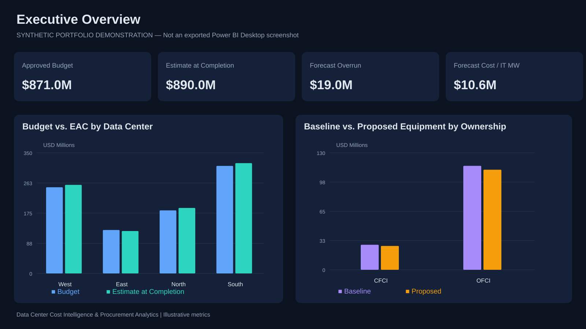
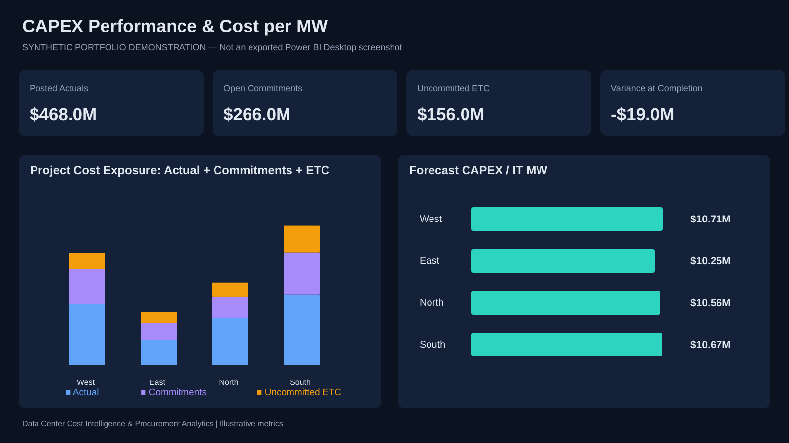
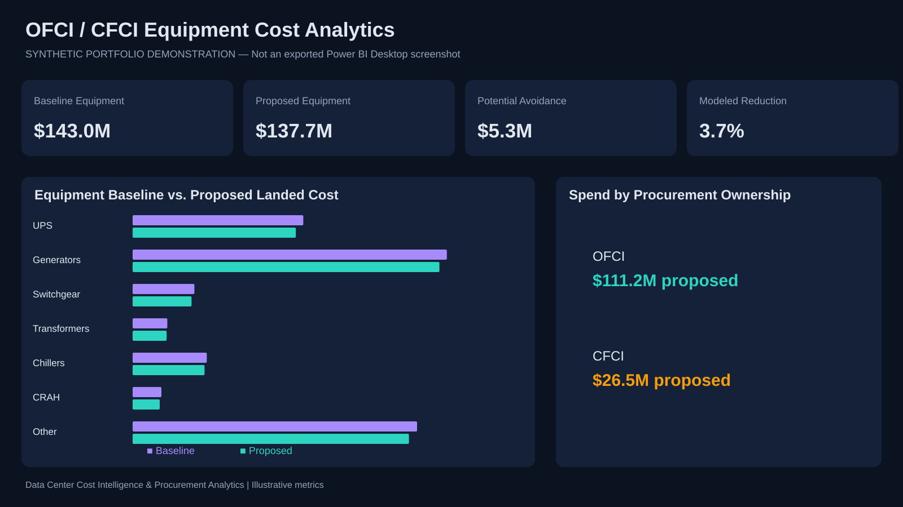
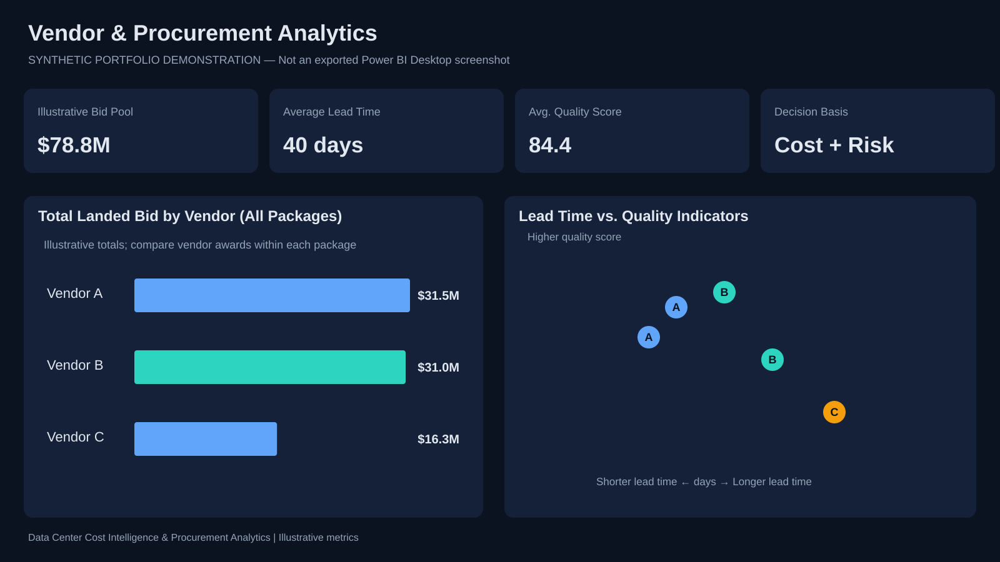
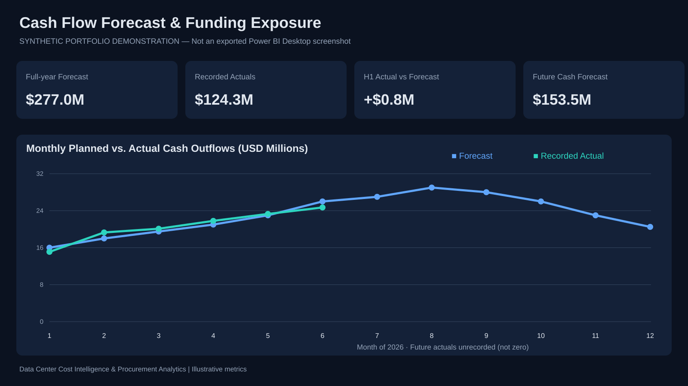

# Data Center Cost Intelligence & FP&A | Analytics Engineering Portfolio

## 📊 Power BI Data Center Cost & Procurement Dashboard

**Five-page editable Power BI Project (PBIP) published:** [Open dashboard source](powerbi/DataCenterCostProcurement.pbip) · [Read setup and modeling notes](powerbi/README.md).

Includes CAPEX tracking, forecast CAPEX per IT MW, OFCI/CFCI procurement cost, multi-vendor total landed cost, and cash-flow forecasting using synthetic data. The project source is versioned in GitHub; an interactive published Power BI report is not hosted here. **Power BI Desktop open/render validation remains pending.**


## Dashboard previews — five executive analytics pages

The five visual previews below are **illustrative recreations made from synthetic data**, not screenshots exported from a validated Power BI Desktop session. The [editable PBIP report source](powerbi/DataCenterCostProcurement.pbip) is in the same repository. Each page is designed to connect a financial metric to a decision a data center executive or FP&A leader must make.

### 1. Executive Overview — portfolio capital exposure


**Purpose:** Show leadership where capital is allocated, how far projects are from completion, and which sites need intervention. **Key KPIs:** approved CAPEX, actuals, EAC, forecast overrun, forecast cost per commissioned IT MW, and OFCI/CFCI equipment spend. **Decision enabled:** prioritize the sites with the largest forecast variances before approving additional capital.

### 2. CAPEX Performance & Cost per MW — project financial control


**Purpose:** Reconcile spend, commitments, and remaining work into a forward-looking cost estimate. **Key KPIs:** actual spend, net open purchase commitments, uncommitted ETC, EAC, variance at completion and normalized $/MW. **Decision enabled:** identify why a site has drifted above budget and whether mitigation or contingency is required.

**Calculation:** EAC = Actuals + net open commitments + uncommitted ETC; forecast cost per MW = EAC / commissioned IT MW.

### 3. OFCI / CFCI Equipment — landed cost intelligence


**Purpose:** Compare baseline versus proposed procurement cost for UPS, generators, switchgear, transformers, chillers, CRAH units and distribution equipment. **Key KPIs:** quantity-adjusted landed cost by equipment type and ownership model, modeled cost reduction and potential cost avoidance. **Decision enabled:** focus sourcing negotiations on high-value equipment packages without reducing redundancy or specification compliance.

### 4. Supplier Comparison — procurement trade-offs


**Purpose:** Explain the trade-off between vendor landed cost, quality and delivery timing. **Key KPIs:** bid cost inclusive of freight, duties, tariffs and escalation; lead times; quality indicators. **Decision enabled:** shortlist suppliers **within the same bid package** rather than selecting the apparently lowest aggregate vendor cost across incomparable packages.

**Calculation:** Total landed bid = Quantity × (unit base + unit freight + unit duties + unit tariffs + unit escalation). Cost avoidance is potential until commercially validated and is **not realized savings**.

### 5. Cash Flow Forecast — funding and payment exposure


**Purpose:** Compare recorded payments with scheduled outflows and expose upcoming liquidity needs. **Key KPIs:** monthly forecast, recorded actual cash, completed-period variance and future scheduled cash payments. **Decision enabled:** sequence procurement payment milestones and provide FP&A or treasury a credible funding outlook.

**Controls:** Future months without recorded payments must be treated as *not yet reported*, not as zero spending. Accrual CAPEX and cash flow have different measurement bases.

### Skills demonstrated
**Power BI / DAX · SQL · Python · Microsoft Fabric modeling · Data-center CAPEX / $ per MW · OFCI/CFCI sourcing · FP&A · Vendor landed cost · Cash-flow forecasting · Executive reporting**

> **Data integrity:** Every number and site is fictional. These previews demonstrate analytical methods, not audited employer savings. The PBIP project has not been opened and validated in Power BI Desktop. No confidential vendor pricing, purchase orders or actual employer project details are used.


**Focus:** data center CAPEX, OFCI/CFCI sourcing, power/cooling cost normalization, procurement variance, vendor performance, financial forecasting and executive decisions.

> **Portfolio demonstration, not employer work product.** All datasets, bids, assumptions and outcomes are synthetic. These are not claims of actual savings at Vantage Data Centers or any other company.

## Why this matters
The lowest quoted equipment price may not be the lowest total project cost once tariffs, freight, escalation, delivery lead times, warranties and commissioning are included. This project connects purchasing decisions to cost per MW, estimate at completion (EAC), cash flow and TCO.

## Repository guide
- [KPI catalog](docs/METRIC_CATALOG.csv): definitions, formulas, units and caveats
- [Python metrics](src/metrics.py): reusable Decimal-based calculations and input guards
- [Runnable case study](src/run_case_study.py): synthetic 24 MW project analysis
- [SQL models](sql/kpi_models.sql): EAC, purchase price variance and project exposure
- [Power BI DAX](docs/POWER_BI_DAX.md): semantic model and measure patterns
- [Decision story](docs/DECISION_STORY.md): executive implications and risk controls
- [Data dictionary](docs/DATA_DICTIONARY.md): KPI definitions and validation
- [Synthetic data](data/): projects and equipment bids
- [Tests](tests/test_metrics.py): Python unit tests

## Run
Python 3.9+; no external dependencies.

```bash
python -m src.run_case_study
python -m unittest discover -s tests -v
```

## Core calculations
| KPI | Calculation | Interpretation |
| --- | --- | --- |
| Forecast CAPEX / IT MW | EAC / commissioned IT MW | Normalized project cost |
| EAC | Actuals + open commitments + uncommitted ETC | Forecast at completion |
| Variance at completion | Approved budget − EAC | Negative = overrun |
| Total landed cost | Unit cost + freight + duties + tariffs + escalation + other | Compare equivalent supplier bids |
| PPV | (Actual unit price − approved baseline price) × quantity | Positive = adverse |
| PUE | Total facility energy / IT equipment energy | Annual energy overhead |

## Synthetic case study
A **24 MW IT** project has **$250M approved budget**, **$140M actuals**, **$81M open commitments** and **$36M remaining uncommitted ETC**. Result: **$257M EAC**, **$7M forecast overrun**, and **$10.708M forecast CAPEX per IT MW**. A separately evaluated four-unit alternative vendor bid indicates **$780K possible cost avoidance**, before specification, schedule and commercial risk checks.

These are illustrative scenarios and are not a claim of realized business results. Do not subtract potential savings from EAC without validating the baseline and reconciling procurement assumptions.

## Proposed Microsoft Fabric architecture
ERP / PO / vendor contracts / metering → Bronze ingestion → Silver quality & normalization → Gold Warehouse dimensional models → certified Power BI semantic model → executive scorecards.

Data governance must define the IT capacity denominator, approved budget baseline, currency and FX date, invoice treatment, PO change orders, supplier-bid comparability and report security.

## Next improvements
1. Dated cash-flow forecast and monthly forecast error.
2. Weighted vendor bid scorecards with lead-time, warranty and reliability factors.
3. A portable Power BI project (`.pbip`) and dashboard screenshots using synthetic data.
4. Automated data-quality validations.

**Contact:** Replace this section with your LinkedIn and professional email before sharing.

## References
- [US Department of Energy: Data Center Design Best Practices](https://www.energy.gov/sites/default/files/2024-07/best-practice-guide-data-center-design.pdf)
- [GitHub profile README documentation](https://docs.github.com/en/account-and-profile/how-tos/profile-customization/managing-your-profile-readme)
